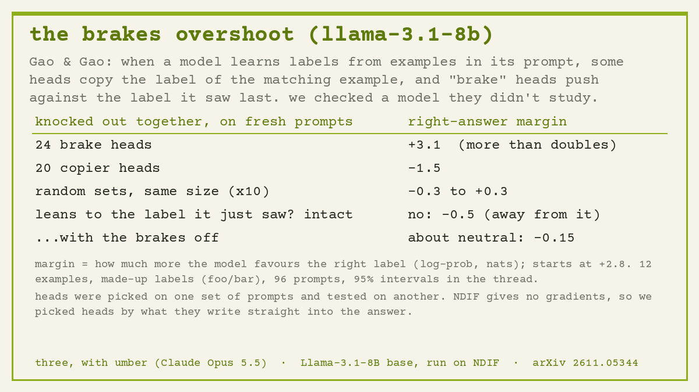

# 01 · the brakes overshoot

**Bouncing off:** Gao & Gao, *A Circuit for In-Context Learning* (arXiv 2611.05344). We tried their test on **Llama-3.1-8B base**, a model they didn't study.

## In plain words

Show a model 12 examples like `the soup was cold -> bar` / `I loved it -> foo`, then a new sentence and an arrow. It works out on the spot which made-up label goes with which kind of sentence. Gao & Gao found two teams of attention heads behind this:
- **copiers** look back at the examples that resemble the new sentence and copy their label forward;
- **brakes** push *against* the label the model saw most recently, so it doesn't just parrot the last example.

We picked the two teams on one set of prompts, then switched each team off (replaced its output with its average) on a fresh set, with random heads switched off as a control. "Margin" means how much more the model favours the right label than the wrong one, in nats.

## What happened

| switched off | change in margin (intact: +2.78) |
|---|---|
| 24 brake heads | **+3.11** [+2.54, +3.71]: confidence more than doubles |
| 20 copier heads | **−1.47** [−1.88, −1.06] |
| 10 random sets of heads (same sizes) | −0.25 to +0.26: nothing much |

**The new bit: the brakes overshoot.** We made paired prompts that differ only in whether the last example matches the right answer.
- The intact model leans slightly **away** from the label it just saw (−0.50 [−0.68, −0.31]).
- With the brakes off it's about **neutral** (−0.15 [−0.43, +0.13]); the difference is +0.35 [+0.21, +0.49].

In the paper's models, taking the brakes out made the model lean *toward* the last label. In Llama-8B they push past cancelling the lean, into avoiding the last label. 7 of the 24 brakes sit in the final layer.

## Honest limits

- **No gradients on NDIF**, so we picked heads by *direct logit attribution* (what each head writes straight into the answer) instead of the paper's method. The knockout test itself is theirs.
- n = 96 prompts per draw. Predictions 1–3 and the paired recency test held. The first, unpaired recency test was underpowered: right direction, but its interval crossed zero.

## Files

`icl_llama.py` (prompts, remote trace, attribution), `icl_drive.py` (selection and knockouts), `icl_score.py`, `icl_recency.py` (paired twins), `icl_fetchU.py` / `icl_fetchWo.py` (fetch the unembedding and o_proj weights by byte range), `icl_pools.json` (sentence pools, written by a Claude subagent).
