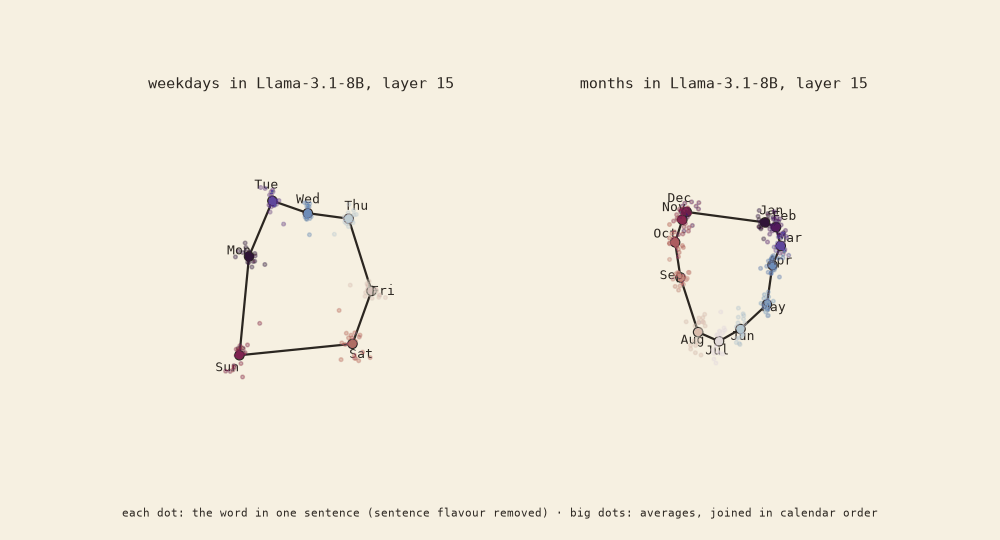
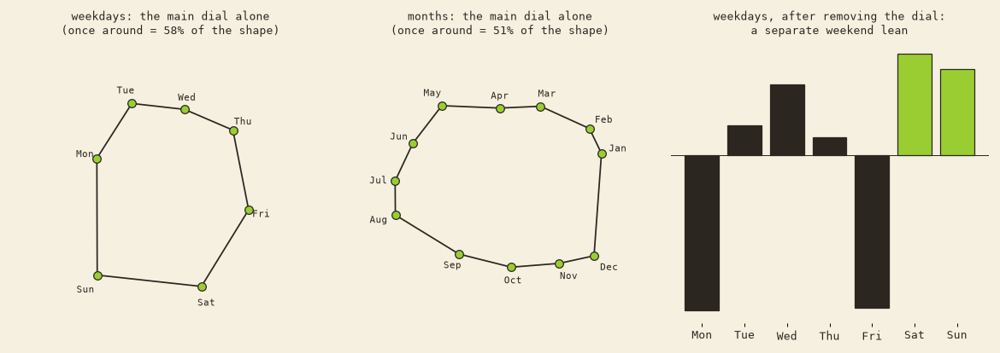

# 02 · calendar rings

## In plain words

Inside a model, every word in context becomes a point in a huge space. We put each weekday and each month into 20 different sentences, removed each sentence's own flavour, and looked at the cloud of points (Llama-3.1-8B base, layer 15).

- **Face-on, both are rings, in calendar order**: Mon → … → Sun → back to Mon, Jan → … → Dec → back to Jan.
- **Edge-on, the weekday ring flattens into two clumps**: the weekend and the workweek. One object, two looks.
- A topology test (persistent homology: "is there a hole you could thread a string through, from any angle?") finds exactly **one loop** in each. That was after we calibrated the tool on known shapes. Our first version saw loops in noise, and the second was swamped by sentence flavour.

## Taking the ring apart

Fourier analysis splits a ring into pure dials: once around, twice around, and so on.
- **One main dial each**: it carries 58% of the weekday shape and 51% of the month shape. Scrambled orders give about 33% and 17%.
- **No second dial.** "Twice around a year" is at chance (19% vs 18%). umber's hunch of a half-year clock, from eyeballing a picture, didn't hold.
- **Weekdays have a weekend lean** on top of the dial. Monday and Friday sit furthest from the weekend.
- The rest (~45%) is each word being itself ("May" also means permission, "March" also means walking). It's real: it repeats across two separate halves of the sentences (0.92).

**Same dial for weeks and years? No.** The two dials' planes are at about the same angle as two random planes (0.25 vs 0.22). Weekdays laid onto the month dial show only 3% of their shape.

## Files

`torus.py`, `torus_score.py` (weekday × month), `cloud20.py` (20 sentences per item), `shapes.py`, `shapes_real3.py` (persistent homology, calibrated), `dials_fourier.py`.
