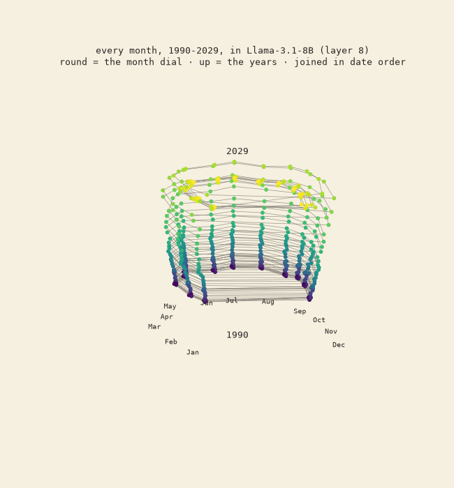
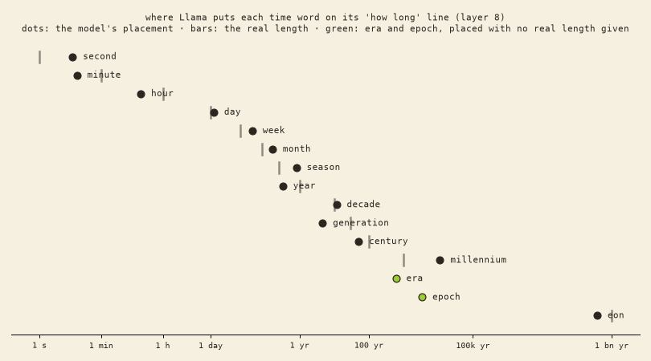

# 03 · a helix? a ladder

## Dates: a stack of rings, not a spring

We wrote every month of 1990–2029 into dates ("It happened in 2005, in March") and read Llama-3.1-8B base at the month.
- **Up is a straight "years" line.** Fit on even years, it puts the odd years in order almost perfectly (0.92–0.97, where 1 is perfect).
- **Round is the month dial**, at right angles to the years.
- **Joined in date order, it's a staircase spiral**, not a smooth helix. In the middle layers the months don't climb within a year, so December 1995 doesn't sit just below January 1996. "Which year" and "which month" are kept as two separate settings.
- **The year's last digit has its own 0–9 dial** (53–60% of the shape at every layer, p < .001), so "1997" is partly "position 7 on a ten-step wheel".

## Time words: a ladder

We put 15 time words in 10 sentences each and asked whether one straight line orders them by length.
- **It does.** Leave each word out and predict its place from the others: the order comes back at 0.92–0.96.
- A few rungs are swapped: "year" sits below "season", "generation" below "decade".
- **Era and epoch** (no fixed length) land **between century and millennium**: "a long stretch of history". **Eon** lands near a billion years.

## Honest limits

Base model only; 2 date templates; one "how long" line, fit on the 13 words with clear lengths. Our first "how helix-like" number was broken (the "May" quirk fooled it), so we went by the pictures and the month-spread numbers instead.

## Files

`helix.py` (NDIF readout), `helix_score.py`.
