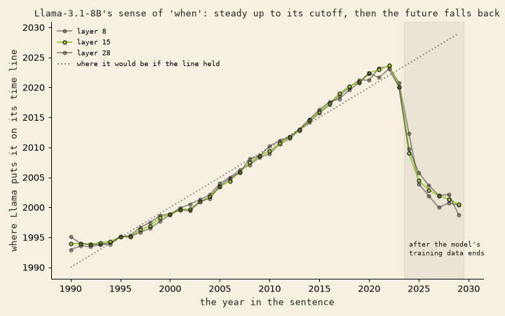

# 04 · the future falls back

## In plain words

Using the "years" line from [03](../03-helix-and-time-ladder/), fit only on 1990–2019, we asked where each year lands in Llama-3.1-8B base. Its training data ends around the end of 2023.

- **1995 → 2022: right on the line.**
- **Then it drops off a cliff.** 2023 lands around 2020. 2025 and later slide back toward **about 2000**. It's the same at every layer.
- **They all fall the same way.** The future years' drifts off the line point almost the same direction (0.80–0.89). The 2010s' drifts are unrelated to each other (about 0).
- **A little less stable:** the two sentence templates agree less about future years (layer 15: 0.80 → 0.63).
- **What the drift points at:** read through the model's vocabulary, against 2020–2023 (which share the same "202" token), future years are pulled **away from "COVID", "pandemic", "coronavirus"** and from **"specifically", "precisely", "actually"**. A future year keeps its 2020s number-shape but loses what was attached to it.

## Honest limits

Exploratory, not pre-registered. Base model, 2 templates, one fit window. Reading a direction through the vocabulary ("logit lens") at middle layers is rough: treat those words as hints. Before leaning on this, rerun it on Instruct and with more templates.

## Files

`helix_future.py` (uses the data from `../03-helix-and-time-ladder/helix.py`).
