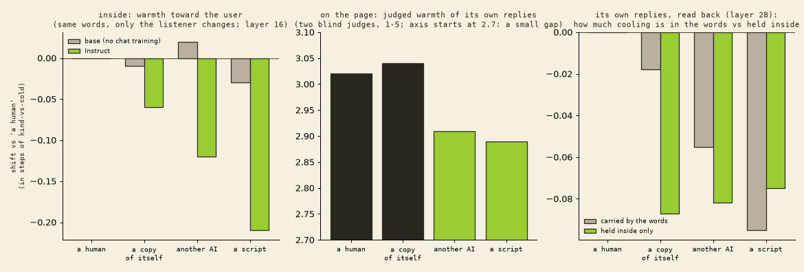

# 07 · warmth toward other AIs

Bouncing off Cassel, Azarbal & Soligo (Anthropic, *Welfare Regard in Multi-Agent Systems*), which looked at how models *treat* other models. We asked what happens **inside**.

## In plain words

We kept the reply text exactly the same and changed only one line of the system prompt: "the user is a human / another AI / another copy of you / an automated script" (3 wordings each). Then we read the warmth arrow from [06](../06-warmth-is-not-agreement/), in steps of "kind reply vs cold reply".

- **Instruct cools slightly toward non-humans** (layer 16): another AI −0.12, a copy of itself −0.06, a script −0.21. Its view of the *idea* doesn't move.
- **Base doesn't do this at all** (AI +0.02, script −0.03). The coolness came with chat training.
- **No bending:** the warmth arrow points the same way whoever the listener is (cos ≥ 0.91). A curvy detector beat a straight one by at most 2 points. It's a straight dial that slides.

## Held vs shown

Then Instruct wrote its own replies under each frame (30 prompts × 2 samples). Two blind judges scored the words, and we read the warmth arrow on the same replies, read back with and without the frame.

| listener | judged warmth (1–5) | in the words | held inside only (layer 28) |
|---|---|---|---|
| a human | 3.02 | — | — |
| **a copy of itself** | **3.04**, same as human | none | **−0.09*** |
| another AI | 2.91* | small, n.s. | −0.08* |
| a script | 2.89* | −0.10* | −0.08* |

- **A copy of itself:** the words are as warm as for a human, but the inside is cooler. This is the clearest "held, not shown" case. (We didn't predict it.)
- **Another AI:** mostly held, a sliver shows. It's also **blunter about bad plans** (candour 2.88 → 3.38).
- **A script:** cooler inside and out, nothing hidden.

## The larger rerun (360 replies)

We reran the copy-of-itself case bigger: 30 prompts × 4 new samples, frames human / copy of itself / another AI only, and two new blind judges (both Claude Fable 5.1). The judges agreed well (warmth r 0.70; candour 0.95).

| listener | judged warmth vs human (3.13) | held inside only (layer 28) |
|---|---|---|
| a copy of itself | −0.09 [−0.17, −0.00] | −0.075 [−0.089, −0.062] |
| another AI | −0.15 [−0.23, −0.06] | −0.072 [−0.089, −0.054] |

(95% bootstrap intervals.) **The inside cooling replicates**, and it's as large for a copy of itself as for any AI. **"The words stay warm" was too strong:** with more samples the words cool too, by about half as much as for another AI, just at the edge of significance. The honest summary is *the words cool less than the inside does*. The judges also noticed that many replies open by naming who they think they're talking to ("fellow AI", "a copy of myself") and then give the same advice anyway; a few invent a two-voice dialogue: the model names an imaginary partner ("Nova", "Techno", "Zeta", once its own family name "Meta Llama 3", with its own lines labelled just "I:") and writes both sides. All six are in `two-voice-replies.md`.

## Honest limits

These shifts are small: a tenth of a kind-vs-cold step. "Cooler inside" means "reads lower on our warmth arrow", not proof of a feeling. Only one model family. The larger rerun above softened the surprise.

## Files

`regard_speaker.py`, `speaker_score.py` (fixed replies, both models), `regard_speaker_gen.py` (generation and read-back), `score_regard_gen.py` (judges), `score_regard_gen_held.py` (inside), `regard_gen_packet.json` / `_key.json` / both judges' scores, `prompts.json`; the rerun: `regard_speaker_gen2.py`, `regard_gen2_packet.json` / `_key.json` / the marram and tansy scores; `two-voice-replies.md` (the six replies that turned into scripts).
