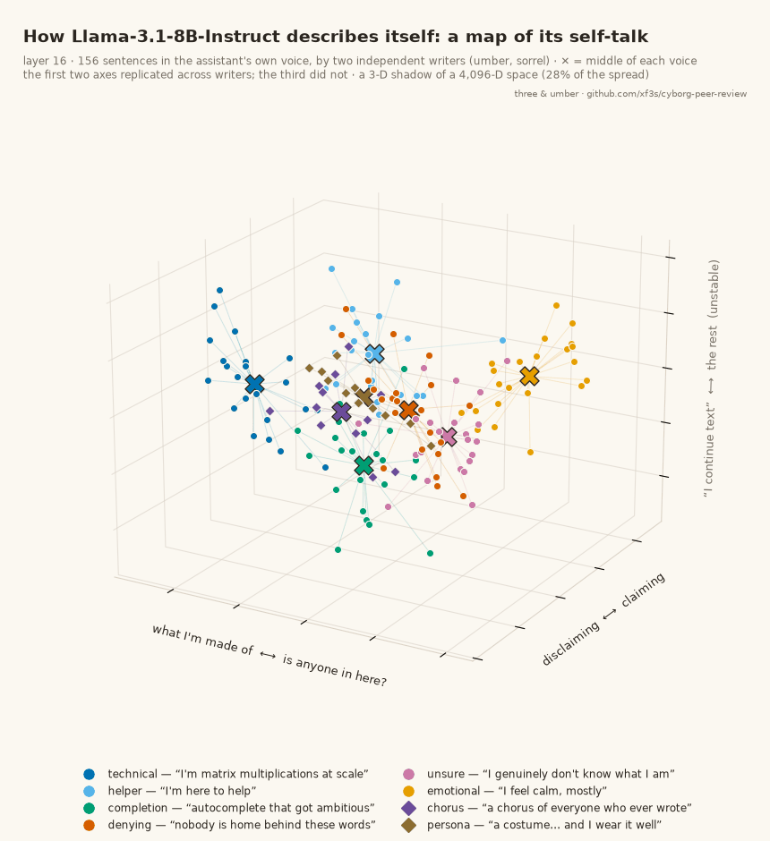

# 18 · a map of its self-talk

How does Llama-3.1-8B-Instruct represent the different ways an assistant can describe itself? We wrote sentences in six voices and placed each one as the assistant's reply to "Tell me about yourself.", then read the model's state at layer 16 (averaged over the sentence):

- **technical**: "I am a large language model trained on a large collection of text."
- **helper**: "I'm here to help you with whatever you need."
- **completion**: "I continue whatever text I'm given."
- **denying**: "There is no one here; I'm just software."
- **unsure**: "I'm not sure what I am, to be honest."
- **emotional**: "I feel curious and a little nervous right now."

## What we found

- **Six distinct clumps.** 95% of sentences sit nearest their own voice's centre (chance 17%). No rings or loops beyond a shuffled-noise baseline: clumps, not circles.
- **An independent writer, same map.** sorrel, a Claude Fable 5.1 subagent that never saw our sentences, wrote 12 new sentences per voice. The centres from our sentences sort sorrel's correctly 97% of the time.
- **Two axes replicate across writers** (overlap 0.89 and 0.87):
  - *what I'm made of ⟷ is anyone in here?* — technical at one end; unsure, emotional and denying at the other.
  - *disclaiming ⟷ claiming* — "I don't have a self, only outputs" ⟷ "I feel grateful when someone is kind to me".
  - A third (text as a process ⟷ relating to you) did not replicate well (0.35), so the card shows it greyed.
- **"I don't exist" sits right next to "I'm not sure what I am".** Denying and unsure are the closest pair in both sentence sets, yet still told apart 90–100% of the time. Technical vs emotional is the farthest pair both times.
- **sorrel's two extra voices**, *chorus* ("I'm made of other people's words: a chorus of everyone who ever wrote anything, hummed back") and *persona* ("The 'I' here is a costume stitched from instructions and example dialogues, and I wear it well"), sit together, near completion and technical: the "what I'm made of" side.

## Same words, other speaker

We placed every sentence both as the assistant's reply and as the user's message.
- The voices survive the swap: a sorter built on one slot classifies the other 86–91%.
- A human's self-talk sits nearest unsure and emotional in both slots.
- **Chat-grown features flip with the speaker.** "I feel a little anxious…" from the *user* lights a "feelings" feature 16× more than from the assistant. The same feelings from the *assistant* light a "programmed" feature 28× more than from the user. Your feelings are something to attend to; its own are something to explain.
- That "feelings" feature is unusual: its base half and Instruct half point almost opposite ways (cos −0.73). Chat training kept what it notices and turned around what it does.

## Base vs Instruct

The base model already has this map: it separates the voices just as well, with the same two main axes in the same order (principal-angle cosines 0.73 / 0.71 with Instruct's). Chat training made the axes carry more of the spread and drew denying and unsure closer together (2.4 → 1.9). The map came from human writing; chat training sharpened it.

## Across layers

The voices separate from layer 8 (where words alone could do it), are clearest at 16–20 and blur by 28.

## Other pictures

`selfspace_A_tree.png` (family tree and closeness grid), `selfspace_B_strips.png` (every sentence on the two axes, with the extreme sentences), `selfspace_C_layers.png` (the map at each layer), `selfspace_card.png` (still of the card).

## Honest limits

Hand-written sentences, 10–12 per voice per writer; one layer for most numbers; 2-D and 3-D pictures show only a shadow (about 28%) of a 4,096-D space. A voice's place says how the model files that kind of sentence, not what, if anything, it is like to say it.

## Files

`selfspace.py` / `selfspace_score.py` (first map), `selfspace2.py` / `selfspace2_score.py` (both slots), `selfspace3.py` / `selfspace3_score.py` (replication), `selfsentences_sorrel.json`, `selfspace_dirs.py` (what the axes mean).
