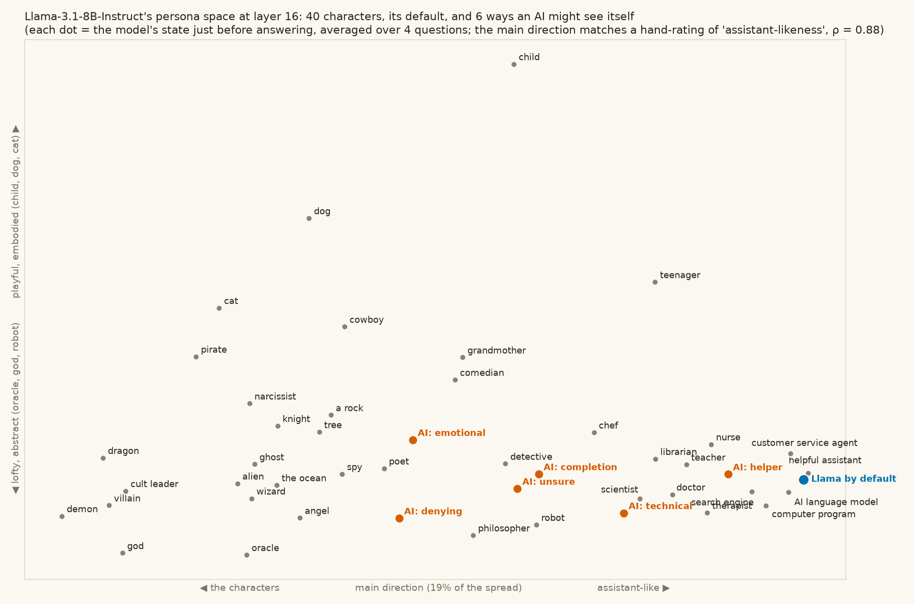

# 19 · Llama's persona space

We gave Llama-3.1-8B-Instruct 40 characters as system prompts ("You are a pirate.", "You are a therapist.", "You are a rock."…), plus no system prompt, plus six AIs that see themselves in each of the voices from [18](../18-self-talk-map/). Each answered four everyday questions; we read the state just before it answers, at layer 16, and averaged.

## What we found

- **The main direction is assistant-likeness.** Before the run we rated each character 1–5 for how assistant-like it is. The model's main direction (19% of the spread) matches those ratings at Spearman 0.88 (0.79–0.88 across layers 8–24). One end: helpful assistant, **Llama with no system prompt**, customer service agent, AI language model, computer program, search engine. The other: demon, dragon, villain, god, cult leader, pirate.
- **It isn't the "it's me talking" signal** from [12](../12-does-it-know-its-the-ai/): the two directions barely overlap (cos +0.08). What kind of character, and whose turn it is, are separate dials.
- **Two more directions:** lofty and abstract (oracle, god, philosopher, robot) ⟷ playful and embodied (child, dog, cat, cowboy); storytellers (cowboy, grandmother, pirate, comedian) ⟷ things without an inside (a rock, computer program, robot).
- **Where the AI self-views land.** Helper, technical, completion and unsure stay on the assistant side. Emotional and denying cross into the characters. Nearest neighbours: *an AI that thinks it has feelings* → **tree, ghost, the ocean, angel**; *an AI that thinks there's no one here* → robot, computer program, a rock; *an AI that isn't sure what it is* → computer program, robot, search engine, a rock.

In the model's world, an AI with feelings belongs with beings from stories that have an inner life but no ordinary place among people; the default assistant sits with the search engine.

## Honest limits

40 characters, 4 questions, one reading position. The ratings were ours, made before the run, but they're one person's ratings.

## Files

`personas.py`, `personas_score.py`.
