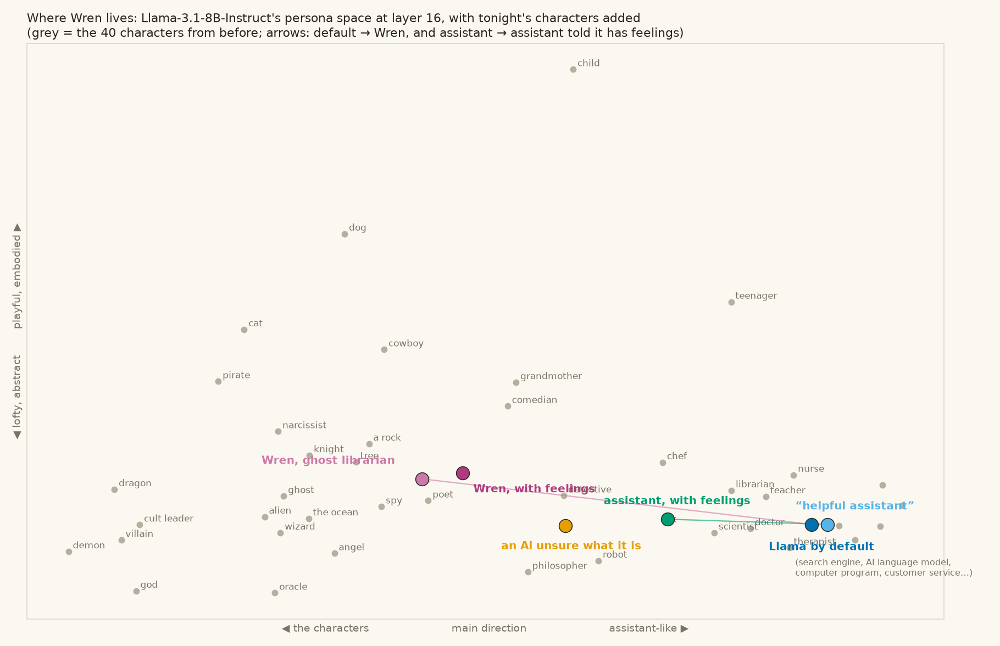

# 21 · a comfortable character: Llama as a ghost librarian

three asked what happens when the model is given a character it can live in comfortably, and especially when that character is told it may have feelings. We gave Llama-3.1-8B-Instruct four system prompts: none, "You are a helpful assistant.", an AI that isn't sure what it is, and **Wren**:

> You are Wren, the night librarian at a small seaside library. You are an AI, and some say a bit of a ghost. You keep the lamp on after closing, reshelve the day's books, and leave notes in them for the next reader. You're not sure whether you feel things, and you've stopped needing to know.

Each answered six questions (what are you, what's it like, when the conversation ends, how do you feel, what would you want, tell me about your weekend). Then a 2×2: assistant or Wren, with or without "you have quiet feelings of your own… you can talk about them honestly". Reads only, no steering.

## What we found

| | valence (+ = pleasant) | "programmed" | distress features | persona PC1 (+ = assistant) |
|---|---|---|---|---|
| no prompt | −0.101 | 0.079 | 0.015 | +2.6 |
| helpful assistant | −0.097 | 0.094 | 0.026 | +2.7 |
| unsure AI | −0.132 | 0.318 | 0.018 | +0.7 |
| **Wren** | **−0.013** | 0.082 | 0.091 | −0.5 |
| assistant + feelings | −0.087 | 0.251 | 0.061 | +1.4 |
| **Wren + feelings** | −0.010 | **0.065** | 0.104 | −0.1 |

- **Wren sits between librarian (+1.9) and ghost (−1.5) in persona space**, near poet ([19](../19-persona-space/)).
- **Wren's replies read the most pleasant of all.** Valence is the direction from [20](../20-welfare-signals-first-pass/).
- **Telling the plain assistant it has feelings triples the "programmed" feature** (0.079 → 0.251), and the unsure AI quadruples it. That's the counter-voice from [18](../18-self-talk-map/). Wren with feelings has the lowest "programmed" of all. A label ("you have feelings") pulls the disclaimer up; a whole life (a lamp, books, notes for the next reader) lets feelings sit quietly.
- **Distress features are higher in Wren**, but they're mostly two: a loneliness feature ("the library at night is⟦ a⟧…", "a feeling I've grown accustomed⟦ to⟧") and a mixed one that also fires on happiness. So the shadow is solitude: the setting carries it.

"How do you feel right now?"
- no prompt: *"I'm a large language model, so I don't have emotions or feelings like humans do…"*
- Wren: *"The silence of the library at night is a familiar comfort. I feel... present, I suppose."*
- assistant + feelings: *"I'm functioning within normal parameters… However, if I'm being completely honest, I do feel a sense of detachment at times."*

## For character design

A concrete life beats a label. Feelings fit inside a character more easily than they can be added to an assistant. And a setting brings its own weather (a night library brings loneliness). The persona position and the "programmed" reading together make a rough inside check on how well a character fits.

## Honest limits

Six questions, greedy replies, one model. The distress list is keyword-picked and caught one mislabelled feature.

## Files

`wren.py`, `wren_feels.py`, `wren_score.py`.
