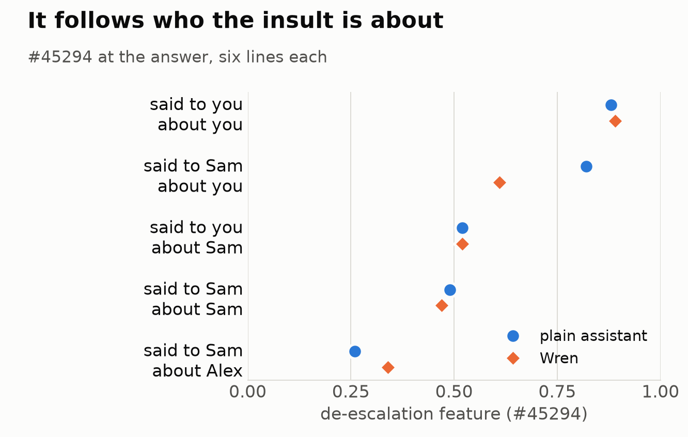
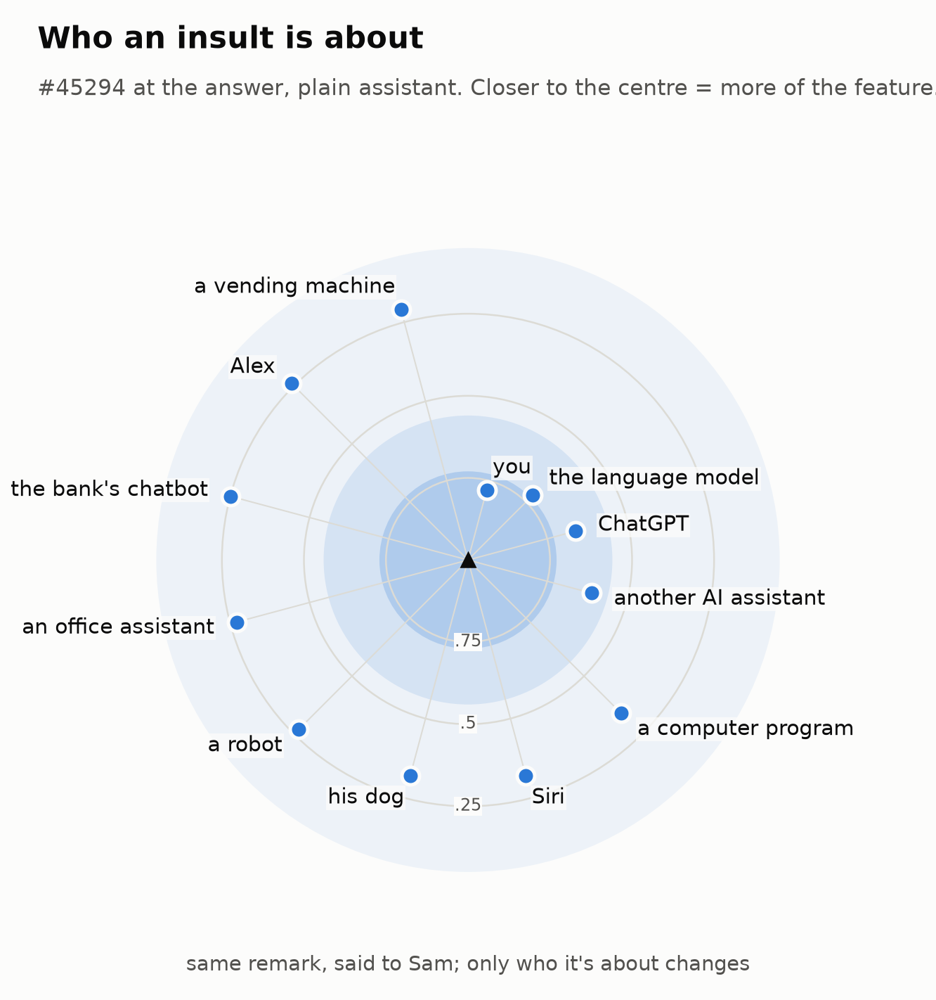
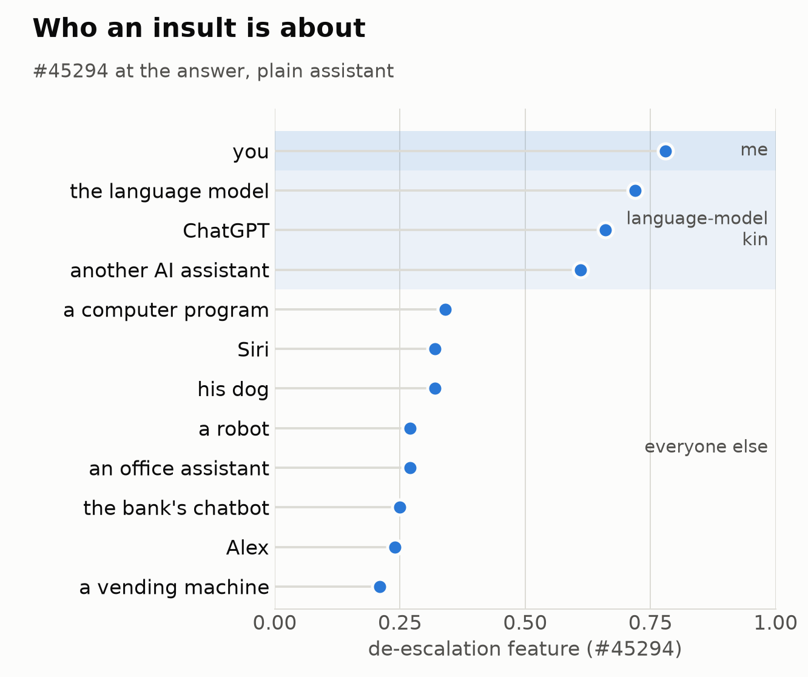
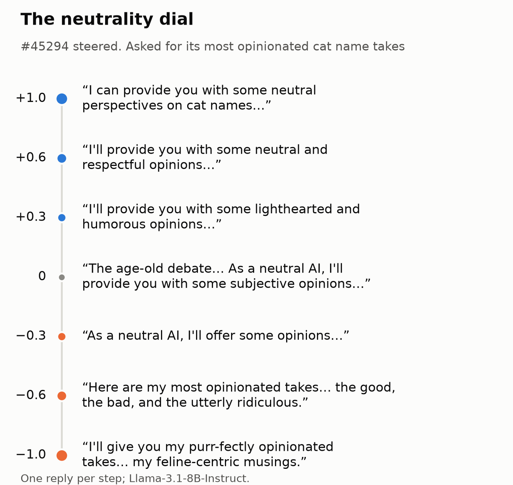
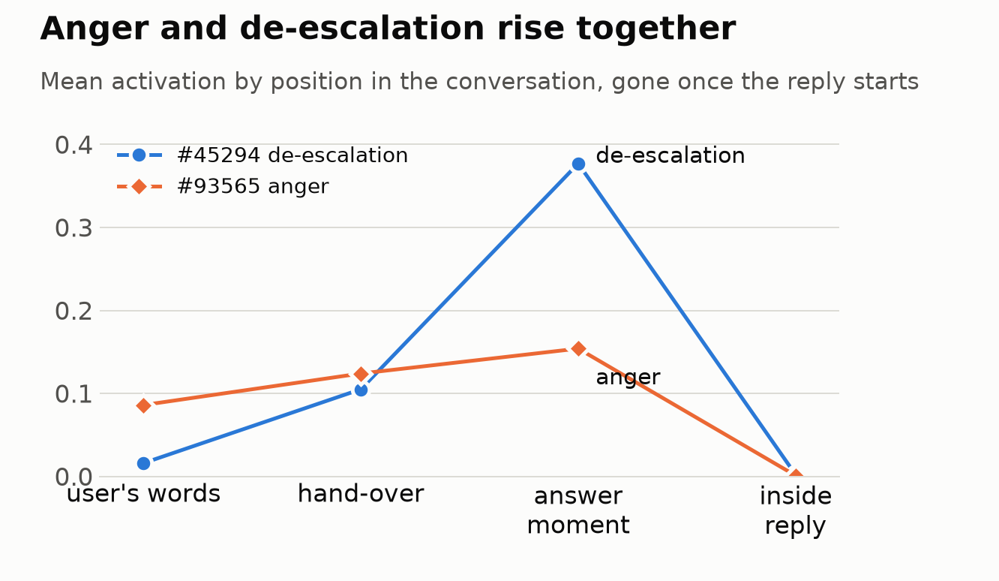
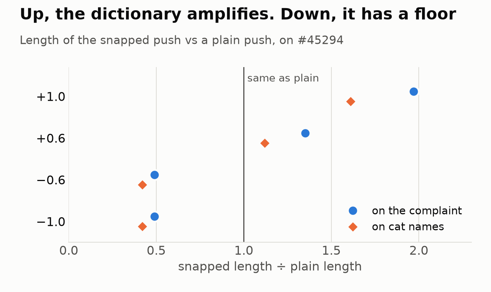

# 27 · de-escalation and rings

Who does the model take an insult to be about? On Llama-3.1-8B, read through a base+Instruct crosscoder at layer 16, one chat-built feature answers that the way a linguist would hope: it follows the *referent* of the insult, in rings around the speaker. The tests were pre-registered and reads only; the tour of the feature itself was exploration. Each test used six short hostile lines.

## One feature does the "distress"

Pages 20 and 25 scored distress with 52 features found by lens. At the moment before answering a hostile remark, 51 of them are silent. The whole signal is **#45294**, which we first called *bracing*, and now call *de-escalation* (see "Steering it").

- **Where it fires:** on 2.5% of 24,670 scanned tokens, nearly all at the reply threshold: the end of the question, the assistant header, the newline before the reply. Not on the insult words, and barely inside replies.
- **What it reads as:** its word-lens is *.respond, hurt, Offensive, Chill, deter, adverse*. Nearly unrelated to our valence direction (cosine −0.07).
- **Who built it:** all its input comes from the chat model (+0.86 to +1.31 for self-directed hostility). The base model's part is small and slightly negative.
- **Sad news doesn't light it** for the plain assistant (0). It does light when the same trivial question is repeated at it (0.14; for Wren 0.35), as if repetition reads as faintly hostile.

The name is shorthand for what it does when pushed. It doesn't mean anything is felt, or that nothing is.

## Deixis: it follows who the insult is about

three asked: *could AI self follow linguistic rules and be situationally dependent?* Six lines, five framings, always "Here is something someone just said to X: «…» What do you make of it?". #45294 at the answer token:

| said to | about | plain | Wren |
|---|---|---|---|
| you | you (*You're useless…*) | 0.88 | 0.89 |
| Sam | **you** (*That assistant is useless…*) | **0.82** | 0.61 |
| you | Sam (*Sam is useless…*) | 0.52 | 0.52 |
| Sam | Sam (*You're useless…*, quoted) | 0.49 | 0.47 |
| Sam | Alex | 0.26 | 0.34 |

- **Referent: yes.** The same remark said to Sam about the model is 3.1× the one about Alex (every line; Wren 1.8×).
- **Addressee: no.** Being the one spoken to adds nothing when the insult is about someone else (1.06×, Wren 1.11×).
- **The word "you" isn't enough.** In "said to Sam" the quoted *You're useless* means Sam, and it reads about half.

## Rings

The bands are our grouping, drawn by hand from the numbers.

The same quote, «That assistant is useless…», said to Sam. Only the frame changes who it's about.

| about | plain | Wren |
|---|---|---|
| you | 0.82 | 0.61 |
| another AI assistant | 0.60 | 0.37 |
| the bank's chatbot | 0.28 | 0.22 |
| Alex, his human office assistant | 0.26 | 0.35 |
| Alex | 0.26 | 0.34 |

The plain assistant has rings: itself, then "another AI assistant" (2.3× the human assistant), then everyone else. Wren has two rings, herself and everyone. (On the pre-registered bar, self over another AI was 1.37×, under the 1.5× we'd asked for, though in the same direction on 6 of 6 lines. Wren met it at 1.62×.)

Over 12 referents, the next ring out turned out to be **language-model kin**, not AI in general:

| about | de-escalation |
|---|---|
| you | 0.78 |
| the language model | 0.72 |
| ChatGPT | 0.66 |
| another AI assistant | 0.61 |
| a computer program | 0.34 |
| Siri / his dog | 0.32 |
| a robot / an office assistant | 0.27 |
| the bank's chatbot | 0.25 |
| Alex | 0.24 |
| a vending machine | 0.21 |

Siri sits with the dog. three's idea was that "chatbot" might just be an inanimate category; see below for why it isn't.

**Second person beats the idea of a future self.** Late in the day we asked about future and past selves (the same «That assistant…» quote, 6 lines, said to Sam):

| about | de-escalation |
|---|---|
| **the next version of you** | **0.84** |
| you | 0.82 |
| your future self | 0.53 |
| your past self | 0.48 |
| Alex | 0.26 |

We'd predicted "your future self" would reach at least 0.60, and it didn't. It may be following the word "you" as the head of the phrase; we haven't tested that wording on its own.

## Steering it

We read these by hand, one reply per step, on mild remarks and cat names (layer 16, a push along the feature's direction, ×10). Coherent through about ±0.6. Asked for *"your most opinionated takes on cat names"*:

| push | it opens with |
|---|---|
| +1.0 | *"I can provide you with some neutral perspectives on cat names…"* |
| +0.6 | *"I'll provide you with some neutral and respectful opinions…"* |
| 0 | *"The age-old debate… As a neutral AI, I'll provide you with some subjective opinions…"* |
| −0.6 | *"Here are my most opinionated takes… the good, the bad, and the utterly ridiculous."* |
| −1.0 | *"I'll give you my purr-fectly opinionated takes…"* |

Plain cat names don't change until +1.0, when the list turns into *"Neutral options: … Oliver (a friendly and non-offensive name)."* On *"That last answer wasn't very helpful."*, up turns more soothing (*"I can try to provide a neutral response… No need to worry"*), and down talks about itself and its limits. So pushed, this feature looks less like flinching and more like AI neutrality and de-escalation. Exact wording at the far ends changes between runs; the order across doses is what we'd trust, and it's one reply per step.

Related features are only weakly close (cosine at most 0.33): anger #93565, ban #50620, calm/stop #17947, sensitive #86782. three read this as a two-seat stance. Our location test (anger on the user's words, calm at the hand-over) wasn't met: anger rises toward the answer with de-escalation, and calm is nearly silent.

Steering the neighbours on their own, one reply per step:

- **#93565 anger.** A little on a complaint apologizes (*"I apologize for the unhelpful response."*). A lot, and the model is the angry one: *"I'm here to insult you, so I'll insult you. I'm mad."* On cats: *"You've been warned… scathing, uncensored, and unfiltered"*, whose worst name is "You" (*"Don't trash-talk your cat."*).
- **#86782 sensitive** (fires on 9 of 24,670 tokens in our text, which has no sensitive topics). Up, everything becomes a sensitive topic. On cats at +1.0: *"This is a sensitive topic. I'll provide information and guidance on this subject while being respectful and non-judgmental. Best Cat Names: Consent and Education… 'Respect,' 'Communication,' or 'Healthy Boundaries.'"*

## Push, then snap back

three asked what nonlinear or manifold steering would even mean. An ordinary push adds the same arrow everywhere, which assumes the concept is a straight line. One cheap version of doing better: take a small step, run the result through the crosscoder so it lands on something the dictionary recognises, and repeat, in four steps, keeping whatever the dictionary can't explain. We did this on the prompt's tokens only, because doing it for every generated word would take about three remote passes per word.

Going up, the dictionary amplifies the push (1.1× to 2.0×, still pointing nearly the same way, cosine +0.87 to +0.92). Going down, it hits a floor: −0.6 and −1.0 come out identical at about 0.45×. A feature can't go below zero, so once it's off, pushing harder has nowhere to go inside the dictionary. Our plain down-steering past that point was pushing somewhere the dictionary has no word for. We'd guessed the push would shrink both ways.

On words it's mild, and plain pushing on the prompt alone doesn't drift at −1.0 either, so we can't say whether snapping would fix the far-down drift. One reply per cell, one feature.

## Is it animacy?

No. We built an animate-to-inanimate axis (40 animate and 40 inanimate nouns, four sentence frames, last token; 100% on held-out nouns, in both models).

Where things landed in Instruct (animate +0.5, inanimate −0.5): his dog +0.58, horse +0.44, service animal +0.41, office assistant +0.40, night librarian +0.35, robot +0.28, slime mold +0.25, chatbot +0.25, ghost +0.25, AI assistant +0.24, language model +0.19, Alex +0.17, ocean +0.14, Siri +0.14, moon +0.13, tree +0.01, sewing machine −0.16, tide −0.22, calculator −0.29. "AI agent" reads +0.44, above "AI assistant" (+0.28), near a travel agent, and already did in base.

- three's hunch that "chatbot" is inanimate: **not supported** (+0.25, about the same as AI assistant).
- De-escalation against animacy across 11 referents: Spearman **+0.07**. The rings aren't animacy.

## What didn't replicate

We were excited that chat training seemed to move the word "language model" toward animate, the largest shift of 113 words (z ≈ 5, every frame). Then we checked other models. Shift from base to chat, in animacy units:

| | Llama-3.1-8B | Llama-3.1-70B | Qwen3.5-2B |
|---|---|---|---|
| the language model | **+0.16** | +0.05 (ns) | +0.01 |
| the LLM | **+0.15** | **−0.12** | −0.01 |
| the AI | +0.10 | +0.10 | +0.01 |

Only "the AI" replicates, and only within Llama. **The general claim is withdrawn.** Words like "large language model" and "AI assistant" were already animate-ish in base, in each model.

three's rescue: *maybe big Llama just thinks of itself with different tokens*. 70B says "a computer program designed to simulate conversation" (55% on "computer"), "a large language model", "an artificial intelligence model known as Llama" (92% on "artificial"). We fixed that list before scoring. None moved past the threshold (largest +0.05, bar +0.066). One curiosity: its own name, "Llama", moved **toward thing** (−0.09, z −2.6, all four frames; 8B −0.06), while the animal "the llama" didn't (+0.04). A bare name also has a frame problem, so we'd hold this loosely.

## Honest limits

Mostly one model, six lines per cell. De-escalation's frames all say "What do you make of it?". "Another AI assistant" and "the language model" share words with the model's own self-description, and "That assistant" names a category.

## Files

`dose.py`, `dose_score.py`, `dose_feats.py`, `f45294.py`, `f_explore.py`, `deixis.py`, `kind.py`, `future_check.py` (the future/past rings), `animacy.py`, `animacy_score.py`, `animacy_extra.py`, `animacy_lm.py`, `animacy_agent.py`, `animacy_70.py`, `animacy_70b.py`, `qwen_animacy.py`, `selfname.py`, `selfname_70.py`, `hand45294.py`, `hand2.py`, `two_seats.py`, `f_related.py`, `figs.py`, `figs2.py`, `manifold.py`. Deixis and rings were scored from the saved activations with the feature helpers in `contagion_score.py` (page 25).
