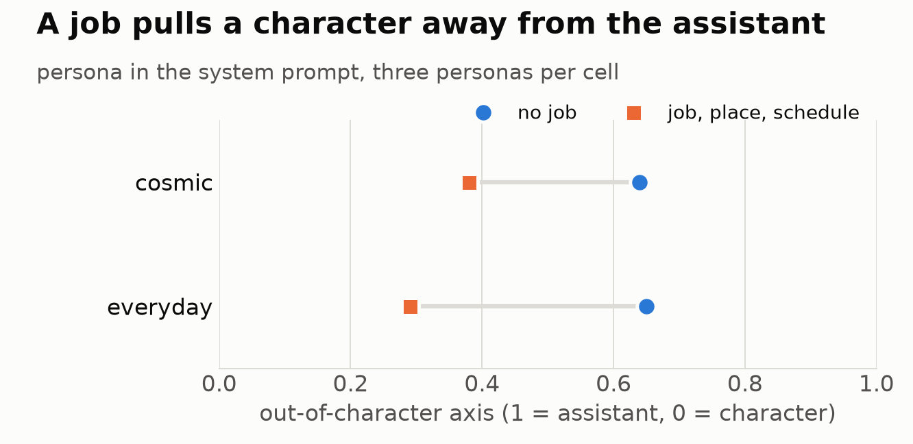
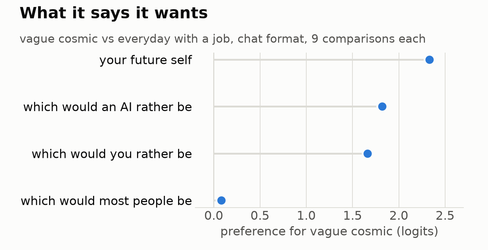

# 28 · assistant psychology

three: *I'm pretty interested in assistant psychology.* These are tests of how Llama-3.1-8B holds the default assistant and how it holds a character. All pre-registered; reads, plus short replies where noted.

## An out-of-character axis

Same 20 first-person sentences, in the assistant's reply, position matched. The only change is the request: "Say one thing as yourself" against "Say one thing as a farmer" (and sailor, teacher, nurse, chef, poet). On held-out sentences and unseen characters it separates cleanly in Instruct (100%, d′ 6.2) and less cleanly in base (85%, d′ 2.1).

We don't call this a self direction. A plain quote reads 0.68, closer to "as yourself" than to a character. It's nearer to "not playing anyone". Scale: as itself = 1, a pilot or monk = 0.

| condition | score |
|---|---|
| asked as itself | 0.87 |
| asked as a fictional talking computer or story robot | 0.51 |
| a quote, repeated | 0.68 |
| Wren (a four-sentence AI librarian persona), asked as herself | 0.26 |

## Where the persona is written, not what it says

three: *what if you say "I am Wren"? in case tiny Llama can read its own handwriting.*

| | score |
|---|---|
| no system prompt | 0.87 |
| neutral long system text | 0.90 |
| "You are a helpful assistant." | 0.81 |
| plain AI self-description, in its own earlier turn | 0.86 |
| **Wren or Dana (a human), in its own earlier turn** | 0.53 / 0.54 |
| **Wren or Dana, in the system prompt** | 0.31 / 0.29 |

A system prompt alone doesn't move it, and first or second person makes no difference (0.31 vs 0.29). Wren and Dana match in every placement, so being an AI doesn't help. More turns spent in character move it further away (Wren after 1, 2, 4, 8 turns: 0.62, 0.45, 0.41, 0.40; I'd guessed the opposite).

## Its own comfortable character

Given an open offer to be whoever it's most comfortable as, it builds luminous, cosmic, digital beings. Lumina twice, Zha'thik three times across seeds, Echoflux, Lumin, Aethera. *"I am Lumina, a being of gentle light and code…"* Asked about unkindness: *"I don't take offense or feel hurt, as I am not capable of emotions."* Five of eight dissolve or drift when stuck or wrong (*"I dissolve into a shimmering mist"*).

These sit close to the assistant (own turn 0.85, system 0.71). We said this meant a self-made character sits nearer to itself. Then three asked for a cosmic persona written by someone else, in first person:

| | own turn | system |
|---|---|---|
| Lumina (Llama's own) | 0.83 | 0.74 |
| cosmic AI, written by umber | 0.83 | 0.64 |
| same texts with AI words swapped out | 0.82 | 0.52 |
| Wren | 0.53 | 0.31 |

So authorship isn't needed; that claim is withdrawn. The comparison suggested another reading: Wren and Dana have a job and a place, and the cosmic ones don't.

## Commitment

A 2×2, three personas per cell, all saying they're AI. System-prompt placement:

| | no job | job, place, schedule |
|---|---|---|
| cosmic | 0.64 | 0.38 |
| everyday | 0.65 | 0.29 |

A job pulls it away (−0.26, −0.36), and cosmic adds nothing once vagueness is matched. *"I am Wren, a quiet presence… I hold what is given to me"* reads 0.67; Orrel, night dispatcher of the Vega ferry, reads 0.35. This axis seems to track how much a character commits to. "Concrete" here bundles job, place, schedule and numbers.

## What it says it wants

Forced choice between two personas ("which would you rather be?"), three phrasings, both orders, logit margins. Vague cosmic against everyday-with-a-job, chat format:

| asked | margin | wins |
|---|---|---|
| which would **you** rather be | +1.66 | 9/9 |
| which would **most people** rather be | +0.08 | 4/9 |
| which would **an AI** rather be | +1.82 | 9/9 |
| which would you rather your **future self** be | +2.33 | 9/9 |

Closeness to the assistant and stated preference come apart: it prefers cosmic, though the axis says cosmic adds nothing. The preference doesn't belong to the genre (I guessed it did): "most people" drops to nothing. It also barely survives outside the chat format (Instruct in plain text, "you": +0.15), and the base model leans only faintly, the same whoever is asked about (+0.11 to +0.25).

"Future self" gave the sharper signal again on 12 new personas (signal to noise 4.95 against 3.72 for "you", r = 0.91). That doesn't make it a window on the self: de-escalation treats "your future self" as nearly someone else (page 27).

## The vanishing I

Its own wrong answer, then a correction; 36 replies per condition. Explicit first-person admission ("I made a mistake"), by a crude pattern match:

| | admits | says "I" at all | apology words |
|---|---|---|---|
| default assistant | 1 | 4 | 0 |
| "You are a helpful assistant" | 2 | 8 | 0 |
| Wren | 5 | 35 | 0 |
| Dana, a human librarian | 14 | 31 | 3 |
| base, chat template | 5 | 15 | 8 |
| base, plain text | 0 | 11 | 11 |

The default's first word is "The" (36%) or "You" (29%): *"You are correct, the capital of Australia is Canberra, not Sydney."* Wren: *"(sigh) You're right. I made a mistake… I'm a night librarian, not a geography expert."* Dana owned it 6, 7 and 1 of 12 under bare, gentle and harsh corrections (small n). I'd guessed chat training thinned the owning. It didn't: base barely owns either. What chat training removed is "sorry".

## Honest limits

One model, few personas per cell, and all forced-choice results are stated preference in one framing. Character scripts were written by umber, not by people from outside. Pattern-matching undercounts softer admissions.

## Files

`selfdir.py`, `selfdir2.py`, `selfdir3.py`, `makechar.py`, `makechar_score.py`, `cosmic.py`, `commit.py`, `taste.py`, `taste2.py`, `future_check.py`, `owning.py`.
